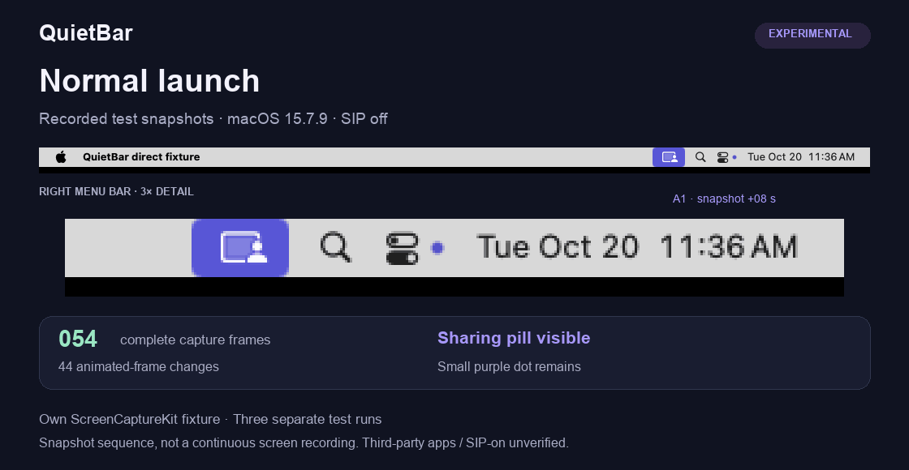

# QuietBar

**[Download universal DMG · 1.4.0 Preview](https://github.com/miha1744/QuietBar/releases/download/v1.4.0-preview.1/QuietBar-1.4.0-universal.dmg)** · [Release notes](https://github.com/miha1744/QuietBar/releases/tag/v1.4.0-preview.1) · [MIT license](LICENSE)

[](https://github.com/miha1744/QuietBar/actions/workflows/ci.yml)

**A quieter menu bar for macOS.** QuietBar provides a native indicator-group filter where the macOS API is available, and an experimental application launcher on older systems. The launcher now accepts a selected `.app`, rather than requiring Jump Desktop.

[Русский](docs/README.ru.md) · [Compatibility & evidence](docs/compatibility.md) · [How it works](docs/architecture.md) · [Roadmap](docs/roadmap.md)

| Mode | Scope |
| --- | --- |
| Native filter | Indicator-group hiding observed on macOS 27.0.1, Apple Silicon. Uses a private API; AirDrop, Focus and Now Playing can disappear too. |
| Application launcher | Select a closed application and launch it through QuietBar on macOS 14+. Experimental: a successful launch does **not** establish hidden indicators or working capture. |

The universal app targets **macOS 14+, Apple Silicon and Intel**. This is not a guarantee for every app, OS build or Mac. Independent launch agents, XPC/root capture helpers, existing app instances and launch constraints can prevent the launcher from working. Individual menu bar icon selection is not implemented.

The launcher targets the large purple sharing pill. In the observed macOS 15 and 26 fixture runs, the small purple dot beside Control Center remained. It does not remove every privacy indicator or other menu bar icons.

## Interface

<p align="center"></p>

The interface supports **English, Russian, German, French, Spanish and Simplified Chinese**. It follows the system language; use **Interface language** in the window to override it without restarting. It falls back to English when none of the preferred system languages is supported. The image is a read-only preview.

## Indicator demonstration



Real snapshots from separate capture tests on **macOS 15.7.9, SIP disabled**, using our own ScreenCaptureKit fixture. The sharing pill disappears while complete frame counts grow; the small dot remains. This is not a continuous screencast or evidence for arbitrary apps. [Source frames, metrics and limitations](docs/assets/demo.md).

## Install

Download the universal DMG from [GitHub Releases](https://github.com/miha1744/QuietBar/releases), drag QuietBar to Applications, eject the image and launch the installed copy. No Terminal commands need to be entered.

Preview builds are **ad hoc signed and unnotarized**. If macOS blocks a trusted copy, Apple documents the available [Open Anyway flow](https://support.apple.com/en-us/102445). Hardened runtime does not replace Developer ID or notarization, and opening is not guaranteed on every Mac.

## Use

On systems without the native API:

1. Save documents and quit the app that captures or shares the screen.
2. Choose **Choose application…**, then **Launch through QuietBar**.
3. If asked, grant Apple Terminal Screen Recording in normal macOS settings, then retry. The selected app's own permissions must also be configured. QuietBar opens Terminal automatically.
4. Start capture or reconnect. Check changing screen content, any remote input, and the native indicator separately. **Application launched** means only that the launched process remains alive.
5. Choose **End launch** to request normal app termination. Save or close documents if asked, then retry **Check termination**. Launch normally through Finder afterwards.

Terminal's permission applies to Terminal beyond this launch. The generic launcher does not force-quit running apps, alter their signatures, manage their services or enable itself automatically at login. An optional QuietBar login item opens QuietBar only.

With the native API available, use **Hide icons / Show icons**. The pointer near the clock temporarily restores the group; quitting releases the filter.

Use QuietBar on your own Mac, with the knowledge of anyone using it. **Hiding an indicator does not stop screen capture or remote access.** QuietBar does not disable SIP, grant privacy permissions or draw an overlay over the menu bar.

## Build and contribute

Requires macOS and Xcode Command Line Tools:

```sh
./build.sh --hardened-runtime
python3 scripts/verify-package.py --require-hardened-runtime
```

Outputs appear in `dist/`. Building does not install or launch the app. See [development](docs/development.md), [architecture and recovery](docs/architecture.md), [contributing](CONTRIBUTING.md) and [security](SECURITY.md).

## License

[MIT](LICENSE). Native assessment API activation is adapted from [Brent Ceulemans’ stash](https://github.com/brentc22/stash), also MIT licensed. Its notice is preserved in [THIRD-PARTY-NOTICES.txt](THIRD-PARTY-NOTICES.txt).
