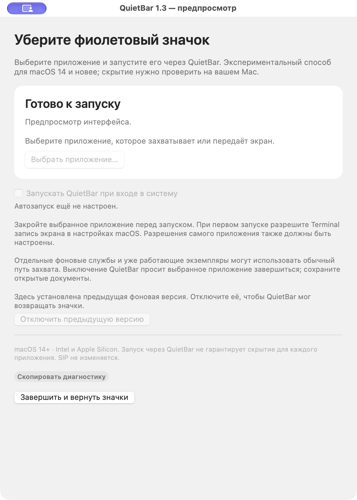

# QuietBar

**[Скачать универсальный DMG · 1.3.1 Preview](https://github.com/miha1744/QuietBar/releases/download/v1.3.1-preview.1/QuietBar-1.3.1-universal.dmg)** · [Примечания к выпуску](https://github.com/miha1744/QuietBar/releases/tag/v1.3.1-preview.1) · [MIT](../LICENSE)

**Спокойная строка меню macOS.** В версии 1.3 запускатель принимает любое выбранное `.app`, а не только Jump Desktop. Если доступен системный API, QuietBar использует общий фильтр группы индикаторов.

[English](../README.md) · [Совместимость и доказательства](compatibility.md) · [Устройство](architecture.md) · [План развития](roadmap.md)

| Режим | Что известно |
| --- | --- |
| Системный фильтр | Скрытие группы наблюдалось на macOS 27.0.1 с Apple Silicon. Частный API может измениться; вместе с индикатором скрываются и некоторые другие системные значки. |
| Запуск выбранного приложения | Экспериментальный способ для macOS 14+. Запущенный процесс сам по себе не подтверждает захват или скрытие индикатора. |

Приложение собирается для **macOS 14+, Intel и Apple Silicon**. Поддержка каждого приложения и каждой версии системы не подтверждена. Независимые службы, XPC/root-процессы захвата, уже работающие экземпляры и ограничения запуска могут мешать этому способу. Выбора отдельных значков строки меню пока нет.

Режим запуска нацелен на большую фиолетовую кнопку демонстрации экрана. В проверенных тестах macOS 15 и 26 маленькая фиолетовая точка рядом с Пунктом управления осталась; остальные значки строки меню тоже сохраняются.

## Интерфейс

<p align="center"></p>

Окно в режиме предпросмотра: запуск и изменение разрешений отключены.

## Установка

Скачайте универсальный DMG из [GitHub Releases](https://github.com/miha1744/QuietBar/releases), перетащите QuietBar в «Программы», извлеките образ и запустите установленную копию. Команды в Терминале вводить не нужно.

Сборка имеет **ad-hoc подпись без нотариального заверения Apple**. Если macOS блокирует доверенную копию, используйте штатную кнопку «Всё равно открыть», если она доступна. См. [инструкцию Apple](https://support.apple.com/102445). Открытие не гарантировано на каждом Mac; hardened runtime не заменяет Developer ID и нотариальное заверение.

## Использование на macOS 14, 15 и 26

1. Сохраните документы и завершите программу, которая захватывает или передаёт экран.
2. Нажмите **«Выбрать приложение…»**, затем **«Запустить через QuietBar»**.
3. При необходимости разрешите Apple Terminal запись экрана через штатные настройки macOS и повторите запуск. Разрешения выбранной программы также должны быть настроены. Terminal откроется автоматически.
4. Начните запись или подключитесь к этому Mac. Отдельно проверьте обновление изображения, управление и отсутствие индикатора. **«Приложение запущено»** означает только, что выбранный процесс продолжает работать.
5. Нажмите **«Завершить запуск»**. Программа получает обычный запрос на завершение; сохраните документы и при необходимости закройте её вручную. Затем нажмите **«Проверить завершение»**. В следующий раз можно запускать программу через Finder как обычно.

Разрешение записи экрана действует на Terminal и другие запускаемые им команды. QuietBar не завершает работающие программы принудительно, не меняет их подписи и не управляет их службами. Выбранное приложение не запускается автоматически при входе. Отдельный флажок автозапуска открывает только QuietBar.

При наличии системного API доступны **«Скрыть значки» / «Показать значки»**. У часов группа временно возвращается, а выход из QuietBar снимает фильтр.

Используйте QuietBar на своём Mac с ведома людей, которые им пользуются. **Скрытие индикатора не останавливает захват экрана или удалённый доступ.** SIP и база разрешений macOS не меняются, накладка поверх строки меню не рисуется.

## Сборка и вклад

На Mac с Xcode Command Line Tools выполните:

```sh
./build.sh --hardened-runtime
python3 scripts/verify-package.py --require-hardened-runtime
```

Результат — в `dist/`. Сборка не устанавливает и не запускает приложение. См. [разработку](development.md), [архитектуру](architecture.md), [участие](../CONTRIBUTING.md) и [безопасность](../SECURITY.md).

Лицензия — [MIT](../LICENSE). Активация частного API основана на [stash](https://github.com/brentc22/stash); исходное уведомление MIT сохранено в [THIRD-PARTY-NOTICES.txt](../THIRD-PARTY-NOTICES.txt).
