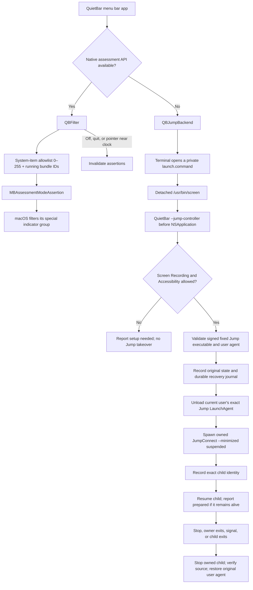

# How QuietBar works

QuietBar is an Objective-C/AppKit menu bar app. It selects a backend by probing the running system for the native assessment API, rather than assuming support from the macOS version. The fallback is a fixed Jump Desktop Connect launch wrapper. Both implement the [`QBHidingBackend`](../Sources/QBFilter.h) interface.



The diagram describes implemented control flow. It does not assert that a connected Jump session captures through the launched child or that its indicator is hidden. See [compatibility and evidence](compatibility.md).

## Native assessment backend

[`QBFilter.m`](../Sources/QBFilter.m) dynamically loads the private `MenuBarClientCore` framework and checks for `MBAssessmentModeConfiguration`, `MBAssessmentModeAssertion` and the required selectors. It creates an assessment configuration with system-item IDs `0…255` and all currently running app bundle identifiers, including QuietBar, Jump and the standard menu bar services.

This is a request to macOS’s own menu bar machinery. QuietBar does not draw a cover over the menu bar, move arbitrary windows or inject code into another process. In the observed compatible system, the special indicator group disappears even with the broad allowlist. AirDrop, Focus and Now Playing may disappear with it. The current app exposes no per-app or per-icon selection.

The backend refreshes the bundle allowlist after app launches, terminations, wake and session activation. New assertions replace old ones only after activation succeeds. A generation counter rejects stale completion callbacks; an error or timeout invalidates the held assertions.

While enabled, a timer checks whether the pointer is in the clock region of any screen. It releases assertions while the pointer is there, then reapplies them after the pointer leaves. Turning the mode off or quitting also releases them. This native path does not request Screen Recording or Accessibility permission.

The private configuration has bundle and system-item allowlists, which makes finer rules a plausible future investigation on compatible systems. Stable item semantics and a selection UI have not been implemented or established across macOS versions.

## Experimental Jump backend

[`QBJumpBackend.m`](../Sources/QBJumpBackend.m) manages the GUI state and session files. [`QBJumpController.m`](../Sources/QBJumpController.m) contains the controller and recovery logic. `main.m` dispatches `--jump-controller` before creating `NSApplication`, keeping that early launch path separate from the GUI’s LaunchServices startup.

The intended launch chain is:

```text
Terminal → detached screen → native QuietBar controller → JumpConnect --minimized
```

The controller inherits the launch chain’s normal process responsibility. It does not use a private responsibility-disclamation call. Public ScreenCaptureKit experiments motivated this approach; they do not prove the same attribution or capture behavior for Jump’s installed helpers.

### Fixed target and permissions

The supported executable is `/Applications/Jump Desktop Connect.app/Contents/MacOS/JumpConnect`. The controller verifies its Phase Five Systems code-signing requirement and checks the exact `com.p5sys.jump.connect.agent` registration and expected arguments. It is not a general launcher for other apps or a universal menu bar manager for macOS 14.

The inherited Screen Recording and Accessibility checks run before creating the takeover journal or changing the Jump job. If either fails, the controller reports a setup state and may make the ordinary macOS permission request. Only the user can approve it in System Settings. Terminal’s permissions are powerful and apply beyond QuietBar’s particular command.

Jump’s **Start Jump Desktop when my computer starts** setting must be enabled manually in Connect. QuietBar does not toggle this preference. With it disabled, the minimized agent can quit; the controller detects the corresponding log message and asks for setup.

### Takeover and restoration

Session state lives under the current user’s `~/Library/Application Support/QuietBar/LegacyJump/`, with private directory/file permissions. A nonce, executable path, user ID, process ID and process start time bind the session to its owner and controller. A lock prevents overlapping controllers.

Before takeover, the controller reads the original root-owned LaunchAgent plist without following a final symlink, checks its expected shape, hashes its exact bytes and snapshots whether the current user’s job was loaded and running. It durably records recovery intent before unloading that user-domain job. The original plist is not rewritten.

The replacement Jump process starts suspended. Its exact identity is written to the journal before it is resumed. After it remains alive for several seconds, the controller publishes `prepared`. Diagnostics deliberately retain `captureVerified: false` and `indicatorVerified: false`; process liveness does not establish a working remote session.

Normal stop, handled signals, owner exit and child exit lead to restoration. The controller stops only its recorded child, verifies that the original source and signed executable still match, and restores the recorded user-agent registration. If the original agent was running, it also verifies that an agent is running again. Recovery of an abandoned journal waits for the original controller to exit and validates identities before acting. External changes or unverifiable restoration produce an error instead of a success state.

The GUI waits for confirmed restoration when quitting. If it cannot confirm completion, it stays open and presents the recovery state. Relaunching also checks abandoned session journals. An active remote connection can be interrupted during preparation or restoration.

### Known recovery limit

An uncatchable `SIGKILL` in the short interval after suspended spawn but before the child identity reaches the journal can leave a suspended orphan. That child has not been resumed and is not capturing. Recovery cannot safely infer its identity from the incomplete journal. The current design therefore does not claim recovery from every possible crash timing.

## System boundaries

QuietBar operates on the current user’s Jump LaunchAgent registration. It does not manage Jump’s root daemon, edit TCC databases, disable SIP or grant itself permissions. Its own optional login registration uses `SMAppService.mainAppService`.

Indicator visibility and capture availability are separate facts. The native path changes visibility; the legacy path changes how one agent is launched. Neither substitutes for the user’s deliberate control of recording and remote access.

## Source map

| File | Responsibility |
| --- | --- |
| [`main.m`](../Sources/main.m) | AppKit UI, backend selection, login item, command-line diagnostics and lifecycle |
| [`QBFilter.m`](../Sources/QBFilter.m) | Native private API, assertion lifecycle, allowlist refresh and clock hover |
| [`QBJumpBackend.m`](../Sources/QBJumpBackend.m) | Legacy GUI state, Terminal launch, polling and recovery coordination |
| [`QBJumpController.m`](../Sources/QBJumpController.m) | Permissions, fixed-target validation, user-agent takeover and journal restoration |
| [`build.sh`](../build.sh) | Universal compilation, local signing and packaging; optional credentialed distribution mode |

The native API activation is adapted from [stash](https://github.com/brentc22/stash). See [THIRD-PARTY-NOTICES.txt](../THIRD-PARTY-NOTICES.txt) for its MIT notice.
